# MMP2
[](https://matlab.mathworks.com/open/github/v1?repo=oscarAMS95/MMP2)

# Práctica 2 — Caos en sistemas biológicos: sistema no lineal de tres poblaciones celulares

Repositorio académico de la asignatura **Modelado Matemático**, correspondiente a la **Maestría en Ciencias de la Ingeniería** del Tecnológico Nacional de México / Instituto Tecnológico de Tijuana. La práctica integra análisis cualitativo de sistemas dinámicos no lineales, localización de conjuntos compactos invariantes, estabilidad local y global, métodos numéricos de diferencias finitas y experimentación *in silico* en MATLAB.

El caso de estudio es un modelo de **tres poblaciones celulares** (células patológicas, células sanas y células efectoras del sistema inmune) que, según el valor de un parámetro de bifurcación, exhibe un **atractor caótico**, una **órbita periódica**, **ciclos límite** o **convergencia a un punto de equilibrio**. Sobre este modelo se determinan condiciones en el tratamiento de inmunoterapia $\rho$ que garantizan la **eliminación de las células patológicas**.

**Docente:** Dr. Paul Antonio Valle Trujillo  
**Departamento:** Ingeniería Eléctrica y Electrónica  
**Institución:** Tecnológico Nacional de México / Instituto Tecnológico de Tijuana  
**Asignatura:** Modelado Matemático  
**Programa:** Maestría en Ciencias de la Ingeniería  
**Alumno:** Oscar Augusto Martinez Salinas - M25210052 - m25210052@tectijuana.edu.mx

---

<a id="contenido"></a>
## Contenido

1. [Resumen](#resumen)
2. [Objetivos](#objetivos)
3. [Modelo matemático](#modelo)
4. [Dinámicas del sistema](#dinamicas)
5. [Análisis matemático](#analisis)
6. [Cálculo simbólico y numérico de equilibrios](#equilibrios)
7. [Métodos numéricos](#metodos)
8. [Experimentación *in silico*](#simulaciones)
9. [Flujo de trabajo computacional](#flujo)
10. [Secciones del cuaderno MATLAB](#actividades)
11. [Funciones auxiliares](#funciones)
12. [Estructura del repositorio](#estructura)
13. [Requisitos](#requisitos)
14. [Reproducibilidad](#reproducibilidad)
15. [Referencias](#referencias)
16. [Licencia y cita](#licencia)
17. [Uso académico](#uso)

---

<a id="resumen"></a>
## Resumen

Esta práctica estudia un sistema de tres ecuaciones diferenciales ordinarias no lineales que describe la interacción entre células patológicas, células sanas y células efectoras (citotóxicas o NK) bajo un tratamiento de inmunoterapia. El análisis matemático establece la **positividad** de las soluciones, calcula los **equilibrios libres de células patológicas** y su **estabilidad asintótica local** mediante la matriz Jacobiana, determina un **dominio de localización** con el método de conjuntos compactos invariantes y, con el **método directo de Lyapunov**, obtiene una condición suficiente de **eliminación global** de las células patológicas.

En la parte computacional se comparan los métodos de **Euler**, **Heun** y **Runge–Kutta de cuarto orden** sobre el atractor caótico, se simulan las cinco dinámicas que presenta el sistema al variar el parámetro de bifurcación $a_{12}$ y se verifican numéricamente las condiciones de eliminación local y global para cada una.

**Palabras clave:** caos; conjuntos compactos invariantes; estabilidad; método directo de Lyapunov; métodos numéricos; simulaciones numéricas; sistema biológico; sistema no lineal.

[Volver al contenido](#contenido)

---

<a id="objetivos"></a>
## Objetivos

### Objetivo general

Comparar métodos de diferencias finitas para solucionar un sistema de EDOs no lineales de primer orden que exhibe diferentes conjuntos compactos invariantes para distintos valores de sus parámetros y condiciones iniciales, y establecer condiciones de eliminación de células patológicas mediante análisis de estabilidad local y global.

### Objetivos específicos

- Establecer la positividad e invariancia del octante no negativo.
- Calcular los equilibrios libres de células patológicas.
- Analizar la estabilidad asintótica local de dichos equilibrios mediante la matriz Jacobiana.
- Determinar los límites de cada variable de estado con el método de localización de conjuntos compactos invariantes.
- Obtener una condición de eliminación global con el método directo de Lyapunov.
- Implementar y comparar los métodos de Euler, Heun y Runge–Kutta de cuarto orden.
- Simular las dinámicas caótica, periódica, de ciclo límite y de equilibrio.
- Verificar numéricamente las condiciones de eliminación local y global.

[Volver al contenido](#contenido)

---

<a id="modelo"></a>
## Modelo matemático

El modelo está formado por tres EDOs no lineales de primer orden:

$$
\dot{x}=r_1x\left(1-b_1x\right)-a_{12}xy-a_{13}xz,
$$

$$
\dot{y}=r_2y\left(1-b_2y\right)-a_{21}xy,
$$

$$
\dot{z}=\left(r_3-a_{31}\right)xz-d_3z+\rho,
$$

donde todos los parámetros son positivos, las condiciones iniciales son no negativas y el parámetro de control (tratamiento de inmunoterapia) cumple $\rho\geq0$.

| Variable | Descripción |
|---|---|
| $x(t)$ | Población de células anormales o patológicas |
| $y(t)$ | Población de células normales o sanas |
| $z(t)$ | Población de células efectoras (citotóxicas o NK) |

| Parámetro | Valor | Descripción |
|---|:---:|---|
| $r_1$ | $1$ | Tasa de crecimiento de las células patológicas |
| $b_1$ | $1$ | Inverso de la capacidad de carga de las células patológicas |
| $a_{12}$ | $[0,1]$ | Fracción de células patológicas eliminadas por las células sanas (parámetro de bifurcación) |
| $a_{13}$ | $2.5$ | Fracción de células patológicas eliminadas por las células efectoras |
| $r_2$ | $0.6$ | Tasa de crecimiento de las células sanas |
| $b_2$ | $1$ | Inverso de la capacidad de carga de las células sanas |
| $a_{21}$ | $1.5$ | Fracción de células sanas eliminadas por las células patológicas |
| $r_3$ | $3$ | Tasa de reclutamiento máximo de células efectoras |
| $a_{31}$ | $0.3$ | Fracción de células efectoras inactivadas por las células patológicas |
| $d_3$ | $0.4$ | Tasa de muerte de las células efectoras |
| $\rho$ | $\geq 0$ | Tratamiento de inmunoterapia |

[Volver al contenido](#contenido)

---

<a id="dinamicas"></a>
## Dinámicas del sistema

Sin tratamiento ($\rho=0$), el sistema exhibe distintos conjuntos compactos invariantes según el valor del parámetro de bifurcación $a_{12}$:

| Dinámica | $a_{12}$ | Condiciones iniciales $(x_0,y_0,z_0)$ | Intervalo de tiempo | Identificador en `getdata` |
|---|:---:|:---:|:---:|:---:|
| Atractor caótico | $1$ | $(0.555,\ 0.148,\ 0.172)$ | $[0,1000]$ | `'chaos'` |
| Órbita periódica | $0.9$ | $(0.254781,\ 0.115167,\ 0.600527)$ | $[0,500]$ | `'orbit'` |
| Ciclo límite interno | $0.8$ | $(0.2,\ 0.6,\ 0.1)$ | $[0,500]$ | `'cyclei'` |
| Ciclo límite externo | $0.75$ | $(0.4,\ 0.2,\ 0.4)$ | $[0,500]$ | `'cyclee'` |
| Punto de equilibrio | $0.5$ | $(0.5,\ 0.5,\ 0.4)$ | $[0,500]$ | `'equilibrium'` |

[Volver al contenido](#contenido)

---

<a id="analisis"></a>
## Análisis matemático

### 1. Positividad e invariancia

Con base en el criterio de De Leenheer y Aeyels [4], se evalúa el campo vectorial sobre las fronteras del octante no negativo:

$$
\left.\dot{x}\right|_{x=0}=0,
\qquad
\left.\dot{y}\right|_{y=0}=0,
\qquad
\left.\dot{z}\right|_{z=0}=\rho\geq0.
$$

Por lo tanto, el octante no negativo

```math
\mathbb{R}_{+,0}^{3}=\left\{(x,y,z)\in\mathbb{R}^{3}\ \middle|\ x\geq0,\ y\geq0,\ z\geq0\right\}
```

es positivamente invariante: toda solución con condiciones iniciales no negativas permanece en él para $t\geq0$.

### 2. Equilibrios libres de células patológicas

Al imponer $x=0$ en el sistema de equilibrio se obtiene $r_2y(1-b_2y)=0$ y $-d_3z+\rho=0$, de donde resultan dos equilibrios:

$$
E_0=\left(x_0^\ast,y_0^\ast,z_0^\ast\right)=\left(0,\ 0,\ \frac{\rho}{d_3}\right),
\qquad
E_1=\left(x_1^\ast,y_1^\ast,z_1^\ast\right)=\left(0,\ \frac{1}{b_2},\ \frac{\rho}{d_3}\right).
$$

$E_1$ representa el estado deseable: no hay células patológicas, las células sanas están en su capacidad de carga y las células efectoras se mantienen en el nivel sostenido por el tratamiento. $E_0$ representa un tejido sin células patológicas ni sanas.

### 3. Estabilidad asintótica local

La matriz Jacobiana del sistema es

$$
J=
\begin{bmatrix}
r_1-2b_1r_1x-a_{12}y-a_{13}z & -a_{12}x & -a_{13}x\\
-a_{21}y & r_2-2b_2r_2y-a_{21}x & 0\\
\left(r_3-a_{31}\right)z & 0 & \left(r_3-a_{31}\right)x-d_3
\end{bmatrix}.
$$

#### Equilibrio $E_1$

Al evaluar en $E_1$ la matriz resulta triangular inferior, por lo que sus valores propios son los elementos de la diagonal:

$$
\lambda_1=r_1-\frac{a_{12}}{b_2}-\frac{a_{13}\rho}{d_3},
\qquad
\lambda_2=-r_2,
\qquad
\lambda_3=-d_3.
$$

Como $\lambda_2,\lambda_3<0$, la estabilidad depende únicamente de $\lambda_1$. Exigir $\lambda_1<0$ conduce a la **condición de eliminación local**:

$$
\rho>\frac{d_3}{a_{13}}\left(r_1-\frac{a_{12}}{b_2}\right).
$$

Si se cumple, $E_1$ es localmente asintóticamente estable y se eliminan poblaciones de células patológicas cercanas al equilibrio. Si $\rho$ es menor que este valor, se observa **persistencia** de las células patológicas.

#### Equilibrio $E_0$ (tarea)

Al evaluar en $E_0$, la matriz también es triangular inferior:

$$
J(E_0)=
\begin{bmatrix}
r_1-\dfrac{a_{13}\rho}{d_3} & 0 & 0\\
0 & r_2 & 0\\
\dfrac{\rho}{d_3}\left(r_3-a_{31}\right) & 0 & -d_3
\end{bmatrix},
$$

con valores propios

$$
\lambda_1=r_1-\frac{a_{13}\rho}{d_3},
\qquad
\lambda_2=r_2>0,
\qquad
\lambda_3=-d_3<0.
$$

El signo de $\lambda_1$ depende de $\rho$ (cambia en $\rho=r_1d_3/a_{13}$), pero $\lambda_2=r_2$ es positivo para cualquier valor del tratamiento. Por lo tanto, **$E_0$ es inestable para todo $\rho\geq0$**: una perturbación pequeña en la población de células sanas crece con tasa $r_2$ y aleja al sistema de este equilibrio.

### 4. Conjuntos compactos invariantes

Para localizar la dinámica se proponen funciones localizadoras $h_i$ y se analiza el conjunto $S(h_i)=\lbrace L_fh_i=0\rbrace$, donde $L_fh_i$ es la derivada de Lie de $h_i$ a lo largo del campo vectorial.

**Variable $x(t)$.** Con $h_1=x$, se tiene $L_fh_1=\dot{x}$ y, al factorizar $x$,

```math
S(h_1)=\left\{x=\frac{1}{b_1}-\frac{a_{12}}{b_1r_1}y-\frac{a_{13}}{b_1r_1}z\right\}\cup\left\{x=0\right\}.
```

Como $y,z\geq0$, los términos restados son no negativos, de modo que

$$
K_x=\left\lbrace 0\leq x(t)\leq\frac{1}{b_1}\right\rbrace.
$$

**Variable $y(t)$.** Con $h_2=y$, de manera análoga,

```math
S(h_2)=\left\{y=\frac{1}{b_2}-\frac{a_{21}}{b_2r_2}x\right\}\cup\left\{y=0\right\},
\qquad
K_y=\left\{0\leq y(t)\leq\frac{1}{b_2}\right\}.
```

**Variable $z(t)$.** Con $h_3=z$,

```math
S(h_3)=\left\{z=\frac{\rho}{d_3}+\frac{r_3-a_{31}}{d_3}xz\right\},
```

y si $r_3-a_{31}>0$ (con los valores del caso de estudio, $r_3-a_{31}=2.7$), el término adicional es no negativo, por lo que

$$
K_z=\left\lbrace z(t)\geq\frac{\rho}{d_3}\right\rbrace.
$$

El dominio de localización es $K=K_x\cap K_y\cap K_z$.

### 5. Estabilidad asintótica global: condición de eliminación

Se aplica el método directo de Lyapunov con la función candidata

$$
V=x,
$$

que es **definida positiva** en el octante no negativo respecto al plano $x=0$ y **radialmente desacotada** en la variable de interés. Su derivada temporal es

$$
\dot{V}=x\left(r_1-b_1r_1x-a_{12}y-a_{13}z\right).
$$

Al evaluarla en el dominio de localización $K$, usando $x\geq0$, $y\geq0$ y $z\geq\rho/d_3$,

$$
\dot{V}\leq x\left(r_1-\frac{a_{13}\rho}{d_3}\right)-b_1r_1x^2,
$$

por lo que $\dot{V}<0$ para todo $x>0$ si se cumple la **condición de eliminación global**:

$$
\rho>\frac{r_1d_3}{a_{13}}.
$$

En ese caso, la población de células patológicas se elimina para cualquier condición inicial positiva y las trayectorias convergen a $E_1=\left(0,\ 1/b_2,\ \rho/d_3\right)$. Cuando la derivada solo es semidefinida negativa, la convergencia se establece con el principio de invariancia de LaSalle, cuyo requisito de acotamiento lo garantiza el dominio de localización $K$.

**Comparación de las condiciones.** Como $a_{12}/b_2\geq0$, la condición global siempre implica la local:

$$
\frac{d_3}{a_{13}}\left(r_1-\frac{a_{12}}{b_2}\right)\ \leq\ \frac{r_1d_3}{a_{13}}.
$$

La condición global no depende del parámetro de bifurcación $a_{12}$, por lo que garantiza la eliminación en las cinco dinámicas del sistema.

[Volver al contenido](#contenido)

---

<a id="equilibrios"></a>
## Cálculo simbólico y numérico de equilibrios

El cuaderno calcula todos los equilibrios del sistema con `solve` (Symbolic Math Toolbox) y la matriz Jacobiana con `jacobian`:

```matlab
syms x y z r1 b1 a12 a13 r2 b2 a21 r3 a31 d3 rho
dx = r1*x*(1 - b1*x) - a12*x*y - a13*x*z == 0;
dy = r2*y*(1 - b2*y) - a21*x*y == 0;
dz = (r3 - a31)*x*z - d3*z + rho == 0;
Eqs = solve([dx,dy,dz], [x,y,z]);
```

Las expresiones resultantes se programan en la función `equilibria`, que evalúa numéricamente los seis equilibrios, calcula los valores propios de la Jacobiana en cada uno y los clasifica como estables, inestables o no identificados.

Con los parámetros del atractor caótico ($a_{12}=1$) y sin tratamiento ($\rho=0$), los equilibrios distintos son:

| Equilibrio $(x^\ast,y^\ast,z^\ast)$ | Valores propios | Clasificación |
|---|---|---|
| $(0,\ 0,\ 0)$ | $1,\ 0.6,\ -0.4$ | Inestable |
| $(0,\ 1,\ 0)$ | $0,\ -0.6,\ -0.4$ | No concluyente |
| $(1,\ 0,\ 0)$ | $2.3,\ -1,\ -0.9$ | Inestable |
| $(0.1481,\ 0,\ 0.3407)$ | $0.3778,\ -0.0741\pm0.579i$ | Inestable |
| $(0.1481,\ 0.6296,\ 0.0889)$ | $-0.6085,\ 0.0413\pm0.2313i$ | Inestable |

Con $a_{12}=1$, el equilibrio $(0,1,0)$ tiene un valor propio nulo, porque el umbral de eliminación local vale exactamente $\frac{d_3}{a_{13}}\left(r_1-\frac{a_{12}}{b_2}\right)=0$. Por eso, en las simulaciones del atractor caótico se usa $\rho=0.01$ en lugar de un múltiplo del umbral.

[Volver al contenido](#contenido)

---

<a id="metodos"></a>
## Métodos numéricos

La función `odesolver` implementa tres métodos de diferencias finitas con paso fijo $h=\Delta t$ para el sistema $\dot{\mathbf{X}}=\mathbf{F}(\mathbf{X})$, con $\mathbf{X}=(x,y,z)$.

### Euler

$$
\mathbf{X}_{n+1}=\mathbf{X}_n+h\,\mathbf{F}(\mathbf{X}_n).
$$

### Heun (Euler mejorado)

$$
\widetilde{\mathbf{X}}_{n+1}=\mathbf{X}_n+h\,\mathbf{F}(\mathbf{X}_n),
\qquad
\mathbf{X}_{n+1}=\mathbf{X}_n+\frac{h}{2}\left[\mathbf{F}(\mathbf{X}_n)+\mathbf{F}(\widetilde{\mathbf{X}}_{n+1})\right].
$$

### Runge–Kutta de cuarto orden

$$
\mathbf{k}_1=\mathbf{F}(\mathbf{X}_n),\quad
\mathbf{k}_2=\mathbf{F}\left(\mathbf{X}_n+\tfrac{h}{2}\mathbf{k}_1\right),\quad
\mathbf{k}_3=\mathbf{F}\left(\mathbf{X}_n+\tfrac{h}{2}\mathbf{k}_2\right),\quad
\mathbf{k}_4=\mathbf{F}\left(\mathbf{X}_n+h\,\mathbf{k}_3\right),
$$

$$
\mathbf{X}_{n+1}=\mathbf{X}_n+\frac{h}{6}\left(\mathbf{k}_1+2\mathbf{k}_2+2\mathbf{k}_3+\mathbf{k}_4\right).
$$

En el código, el método se elige por nombre y el tratamiento se recibe como un vector `rhoi` con un valor por paso de tiempo:

```matlab
[t,x,y,z] = odesolver(method,f0,par,rhoi,tend,dt);   % method = 'Euler' | 'Heun' | 'Runge-Kutta'
```

```matlab
case "runge-kutta"
    [k1x,k1y,k1z] = f(x(i),y(i),z(i),rhoi(i));
    [k2x,k2y,k2z] = f(x(i)+k1x*dt/2, y(i)+k1y*dt/2, z(i)+k1z*dt/2, rhoi(i));
    [k3x,k3y,k3z] = f(x(i)+k2x*dt/2, y(i)+k2y*dt/2, z(i)+k2z*dt/2, rhoi(i));
    [k4x,k4y,k4z] = f(x(i)+k3x*dt,   y(i)+k3y*dt,   z(i)+k3z*dt,   rhoi(i));
    x(i+1) = x(i) + (k1x + 2*k2x + 2*k3x + k4x)*dt/6;
    y(i+1) = y(i) + (k1y + 2*k2y + 2*k3y + k4y)*dt/6;
    z(i+1) = z(i) + (k1z + 2*k2z + 2*k3z + k4z)*dt/6;
```

Para reducir el tamaño de las figuras, al final de `odesolver` las soluciones se submuestrean a una resolución temporal de $0.1$ (variable `h = 10`).

[Volver al contenido](#contenido)

---

<a id="simulaciones"></a>
## Experimentación *in silico*

### 1. Comparación de métodos numéricos: atractor caótico

Atractor caótico ($a_{12}=1$, $\rho=0$) con $\Delta t=10^{-3}$ en $t\in[0,1000]$:

| Euler | Heun | Runge–Kutta |
|:---:|:---:|:---:|
| 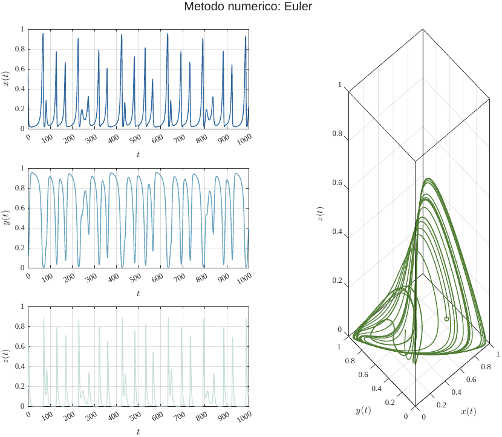 | 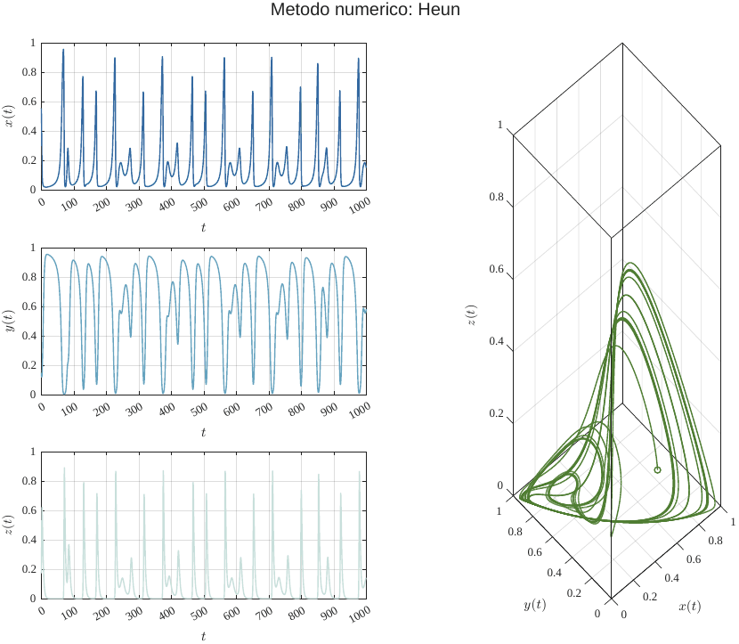 | 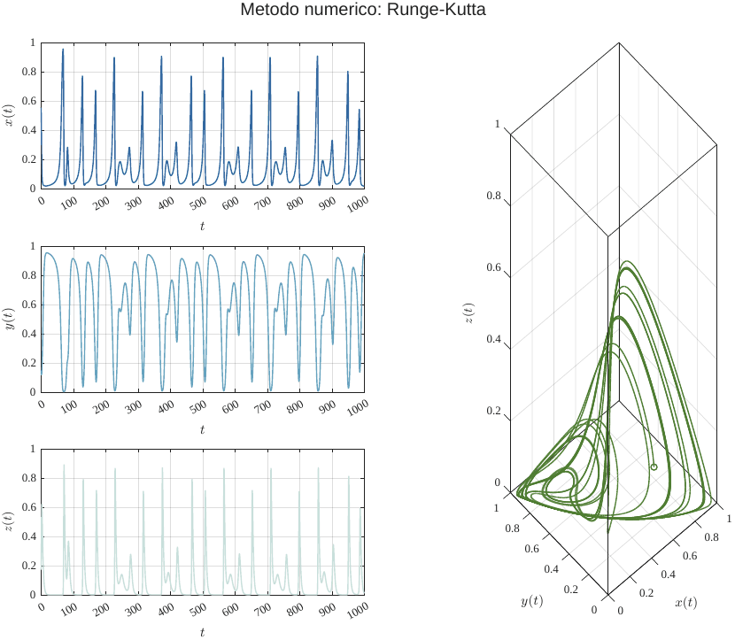 |

Cada figura muestra las soluciones $x(t)$, $y(t)$, $z(t)$ y la trayectoria en el espacio de fase $(x,y,z)$. Por la sensibilidad a las condiciones iniciales propia del caos, pequeñas diferencias de truncamiento entre métodos producen series temporales que se separan con el tiempo, aunque las tres reproducen la misma geometría del atractor.

### 2. Dinámicas del sistema sin tratamiento

Simulaciones con Runge–Kutta, $\Delta t=10^{-3}$ y $t\in[0,500]$:

| Órbita periódica ($a_{12}=0.9$) | Ciclo límite interno ($a_{12}=0.8$) |
|:---:|:---:|
| 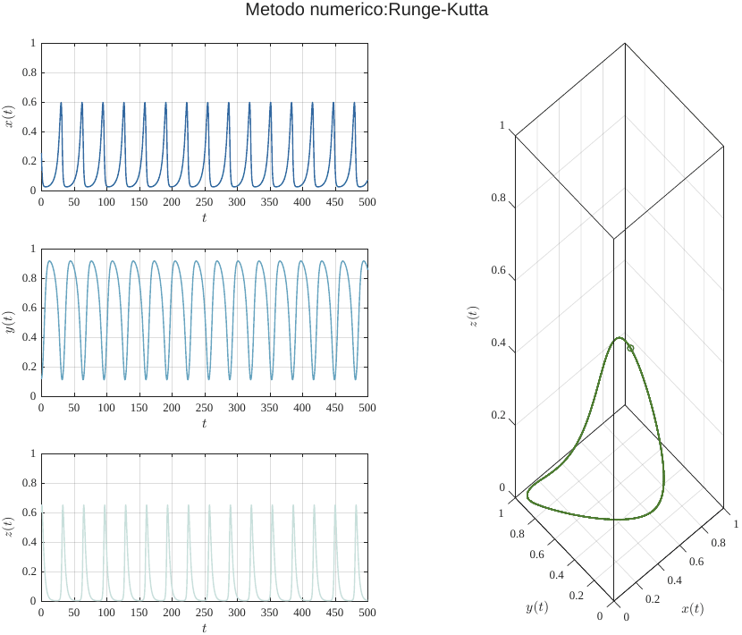 | 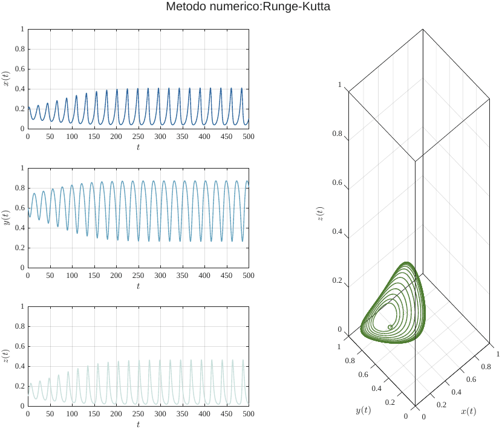 |
| **Ciclo límite externo ($a_{12}=0.75$)** | **Punto de equilibrio ($a_{12}=0.5$)** |
| 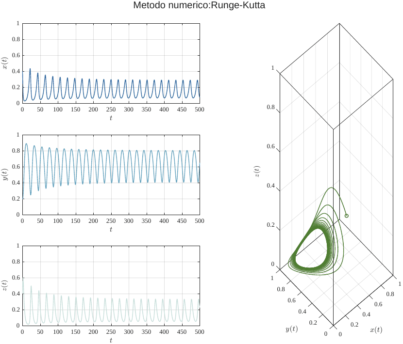 | 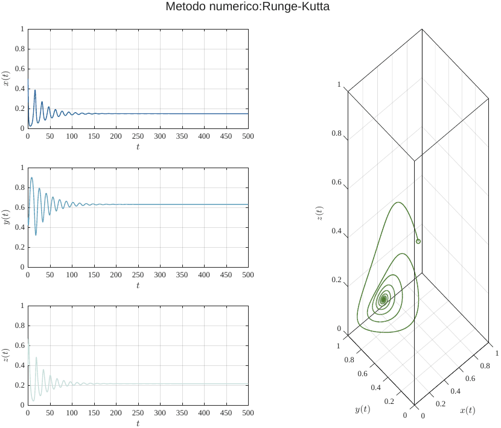 |

### 3. Verificación de las condiciones de eliminación

Para cada dinámica se aplica un tratamiento constante ligeramente superior al umbral correspondiente y se simula con Runge–Kutta, $\Delta t=10^{-4}$ y $t\in[0,50]$. En las figuras, la cruz roja indica los equilibrios del sistema y el círculo la condición inicial.

| Dinámica | $a_{12}$ | Umbral local | $\rho$ local simulado | Umbral global | $\rho$ global simulado |
|---|:---:|:---:|:---:|:---:|:---:|
| Atractor caótico | $1$ | $0$ | $0.0100$ | $0.16$ | $0.1616$ |
| Órbita periódica | $0.9$ | $0.016$ | $0.01616$ | $0.16$ | $0.1616$ |
| Ciclo límite interno | $0.8$ | $0.032$ | $0.03232$ | $0.16$ | $0.1616$ |
| Ciclo límite externo | $0.75$ | $0.040$ | $0.0404$ | $0.16$ | $0.1616$ |
| Punto de equilibrio | $0.5$ | $0.080$ | $0.0808$ | $0.16$ | $0.1616$ |

El umbral local es $\frac{d_3}{a_{13}}\left(r_1-\frac{a_{12}}{b_2}\right)$ y el global es $\frac{r_1d_3}{a_{13}}$. En los casos con umbral positivo, el tratamiento simulado es $1.01$ veces el umbral.

#### Condición local

| Atractor caótico | Órbita periódica | Ciclo límite interno |
|:---:|:---:|:---:|
| 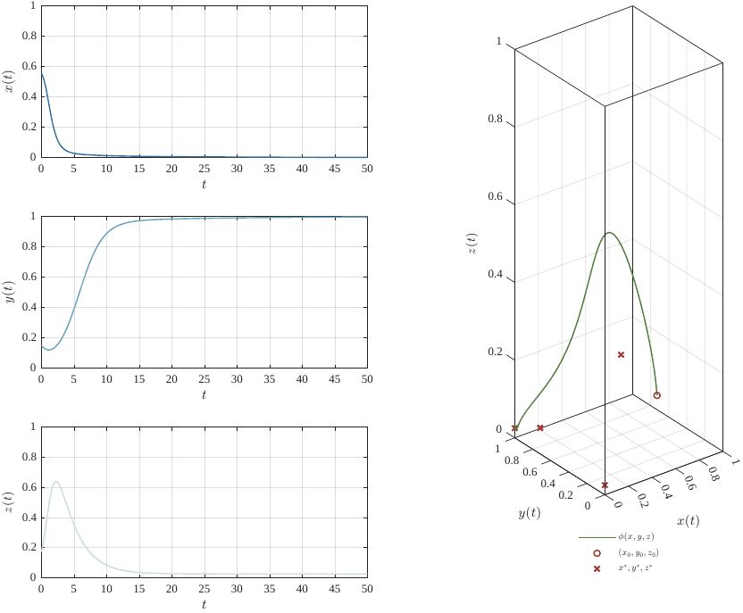 | 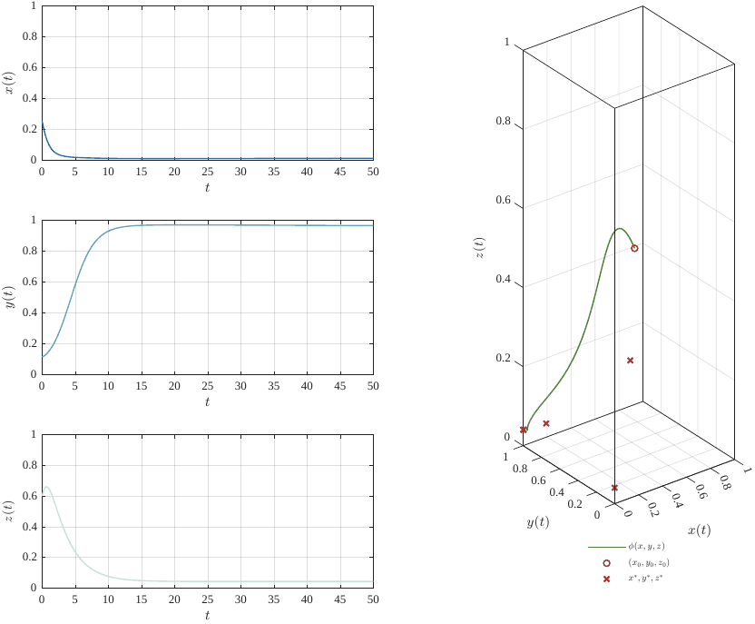 | 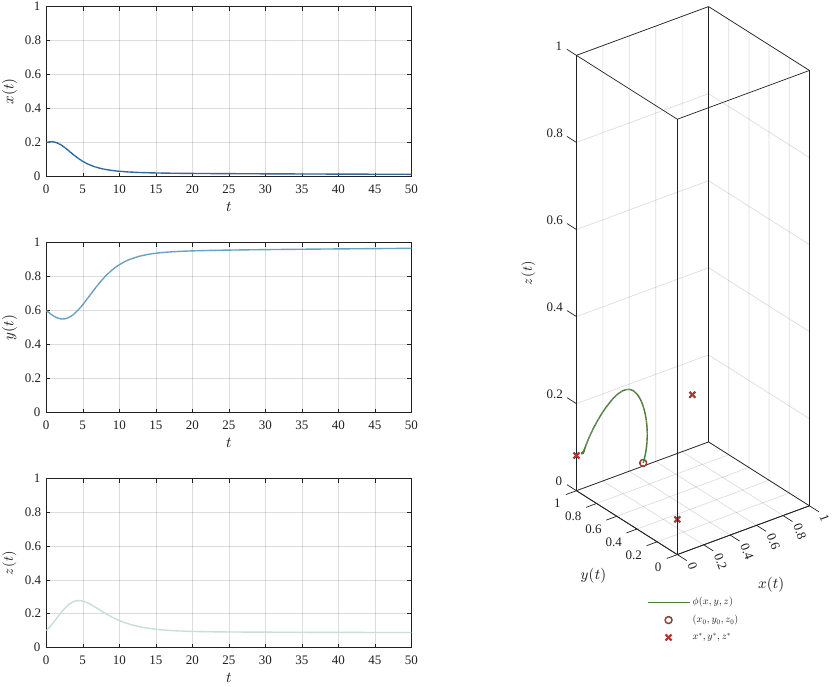 |
| **Ciclo límite externo** | **Punto de equilibrio** | |
| 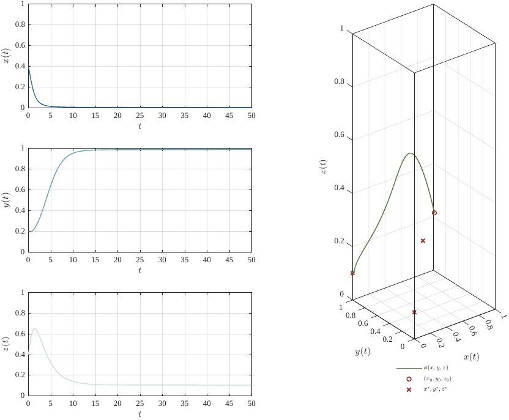 | 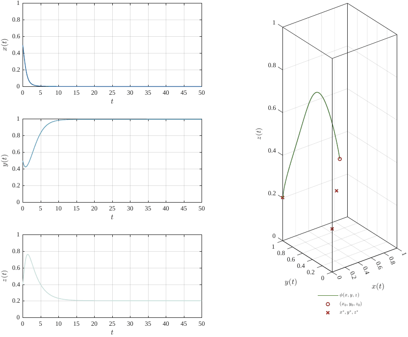 | |

#### Condición global

| Atractor caótico | Órbita periódica | Ciclo límite interno |
|:---:|:---:|:---:|
| 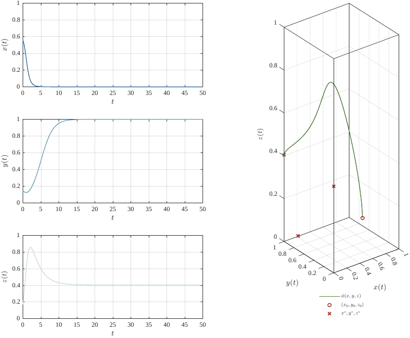 | 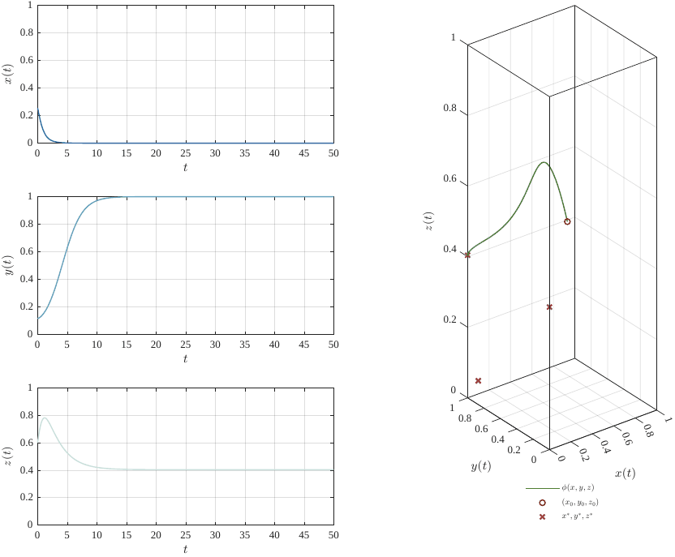 | 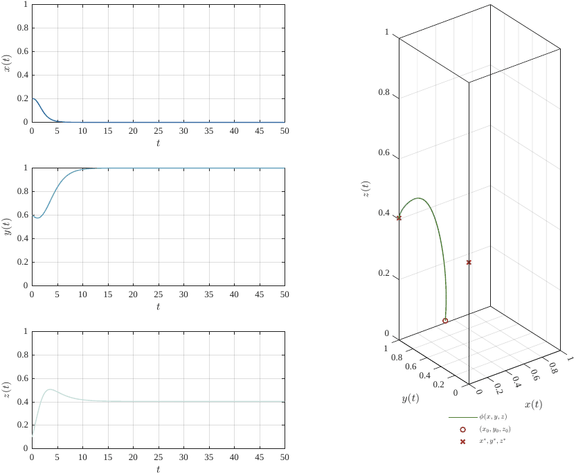 |
| **Ciclo límite externo** | **Punto de equilibrio** | |
|  | 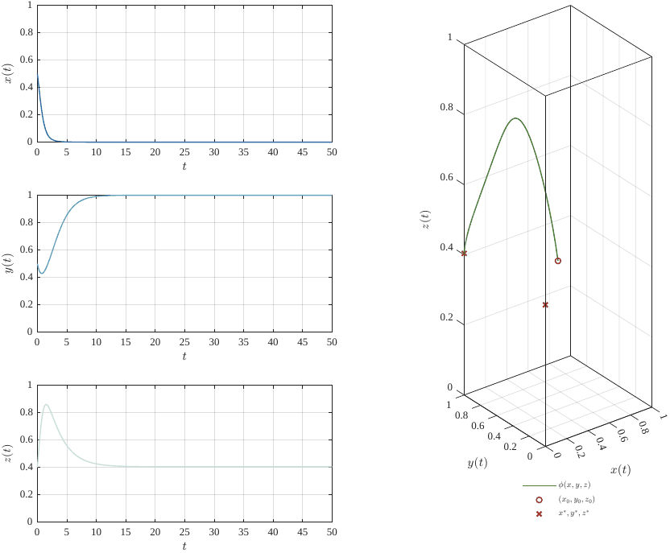 | |

En todos los casos, $x(t)\to0$ y las trayectorias convergen a $E_1=\left(0,\ 1/b_2,\ \rho/d_3\right)$. Con la condición local, $z(t)$ se estabiliza en valores entre $0.025$ y $0.202$, según la dinámica; con la condición global, en $\rho/d_3\approx0.404$ para las cinco dinámicas. La condición local solo garantiza la eliminación cerca del equilibrio, aunque en estas simulaciones también se observa desde las condiciones iniciales consideradas; la condición global la garantiza para cualquier condición inicial positiva.

[Volver al contenido](#contenido)

---

<a id="flujo"></a>
## Flujo de trabajo computacional

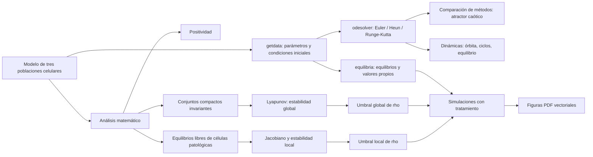

El flujo conecta el análisis cualitativo del sistema con su solución numérica: los umbrales de tratamiento obtenidos analíticamente se verifican mediante simulación en cada una de las dinámicas del modelo.

[Volver al contenido](#contenido)

---

<a id="actividades"></a>
## Secciones del cuaderno MATLAB

El archivo `Martinez25210052.mlx` constituye el cuaderno computacional principal y se organiza en las siguientes secciones:

### 1. Información general

- Nombre del alumno, número de control, correo institucional, asignatura y docente.

### 2. Datos de la simulación

- Limpieza del espacio de trabajo.

### 3. Comparación de métodos numéricos: atractor caótico

- Euler.
- Heun.
- Runge–Kutta.

### 4. Dinámicas del sistema

- Órbita periódica.
- Ciclo límite interno.
- Ciclo límite externo.
- Ciclo de equilibrio.

### 5. Condiciones de estabilidad asintótica local

- Simulación de las cinco dinámicas con $\rho$ ligeramente mayor que el umbral local.

### 6. Cálculo de equilibrios

- Equilibrios simbólicos con `solve`.
- Equilibrios numéricos con `equilibria`.

### 7. Matriz Jacobiana

- Cálculo simbólico con `jacobian`.
- Simulación de las cinco dinámicas con $\rho$ ligeramente mayor que el umbral de eliminación global.

### 8. Funciones

- Métodos numéricos (`odesolver`).
- Soluciones y trayectorias (`plotEDOs`, `plotCCI`).
- Parámetros y condiciones iniciales (`getdata`).
- Equilibrios (`equilibria`).

[Volver al contenido](#contenido)

---

<a id="funciones"></a>
## Funciones auxiliares

| Función | Propósito |
|---|---|
| `getdata` | Devuelve el vector de parámetros y las condiciones iniciales de cada dinámica (`'chaos'`, `'orbit'`, `'cyclei'`, `'cyclee'`, `'equilibrium'`) |
| `odesolver` | Integra el sistema con Euler, Heun o Runge–Kutta de cuarto orden, con tratamiento $\rho(t)$ variable en el tiempo, y submuestrea la solución |
| `equilibria` | Evalúa numéricamente los seis equilibrios del sistema, calcula los valores propios de la Jacobiana y clasifica su estabilidad |
| `plotEDOs` | Grafica $x(t)$, $y(t)$, $z(t)$ y la trayectoria en el espacio de fase |
| `plotCCI` | Igual que `plotEDOs`, y además marca la condición inicial y los equilibrios del sistema |

Todas las figuras se exportan con `exportgraphics(...,'ContentType','vector')`.

[Volver al contenido](#contenido)

---

<a id="estructura"></a>
## Estructura del repositorio

```text
.
├── README.md
├── Martinez25210052.mlx                 # Cuaderno computacional principal
├── MartinezM25210052.pdf                # Desarrollo matemático de la práctica
├── CITATION.cff                         # Metadatos para citar el repositorio
├── LICENSE                              # Licencia BSD 2-Clause
├── img/                                 # Figuras en PNG para este README
└── Simulaciones numericas/              # Figuras vectoriales (PDF) generadas por MATLAB
    ├── Euler_Chaos.pdf
    ├── Heun_Chaos.pdf
    ├── Runge-Kutta_Chaos.pdf
    ├── Runge-Kutta_Orbit.pdf
    ├── Runge-Kutta_Internal.pdf
    ├── Runge-Kutta_External.pdf
    ├── Runge-Kutta_Equilibrium.pdf
    ├── Equilibria_Atractor.pdf          # Condición local: atractor caótico
    ├── PeriodicOrbit_Atractor.pdf       # Condición local: órbita periódica
    ├── InternalCycle_Atractor.pdf       # Condición local: ciclo límite interno
    ├── ExternalCycle_Atractor.pdf       # Condición local: ciclo límite externo
    ├── Equilibrium_Atractor.pdf         # Condición local: punto de equilibrio
    ├── Global_Atractor.pdf              # Condición global: atractor caótico
    ├── Global_Stability_Orbit_Atractor.pdf
    ├── Global_InternalCycle_Atractor.pdf
    ├── Global_ExternalCycle_Atractor.pdf
    ├── Global_Equilibrium_Atractor.pdf
    └── Stability_Orbit_Atractor.pdf
```

[Volver al contenido](#contenido)

---

<a id="requisitos"></a>
## Requisitos

Para ejecutar todas las secciones del repositorio se requiere:

- MATLAB (con soporte para cuadernos `.mlx`).
- Symbolic Math Toolbox.
  - `syms`
  - `solve`
  - `jacobian`
  - `simplify`

Los métodos numéricos están implementados directamente en el cuaderno, por lo que no se requiere Simulink ni funciones ODE adicionales.

[Volver al contenido](#contenido)

---

<a id="reproducibilidad"></a>
## Reproducibilidad

Para reproducir el análisis completo:

1. Abrir `Martinez25210052.mlx` en MATLAB o en MATLAB Online (botón al inicio de este documento).
2. Ejecutar **Comparación de métodos numéricos: atractor caótico** para obtener las figuras de Euler, Heun y Runge–Kutta.
3. Ejecutar las secciones de **órbita periódica**, **ciclo límite interno**, **ciclo límite externo** y **ciclo de equilibrio**.
4. Ejecutar **Condiciones de estabilidad asintótica local** y verificar que $x(t)\to0$ en las cinco dinámicas.
5. Ejecutar **Cálculo de equilibrios** para obtener los equilibrios simbólicos, numéricos y su clasificación.
6. Ejecutar **Matriz Jacobiana** y las simulaciones con el umbral de eliminación global.
7. Relacionar los resultados numéricos con el desarrollo matemático de `MartinezM25210052.pdf`.

### Resultados mínimos esperados

- Comparación de los métodos de Euler, Heun y Runge–Kutta sobre el atractor caótico.
- Soluciones temporales y trayectorias de las cinco dinámicas del sistema.
- Tabla de equilibrios con sus valores propios y clasificación de estabilidad.
- Matriz Jacobiana simbólica.
- Simulaciones que verifiquen la eliminación de células patológicas con las condiciones local y global.
- Figuras vectoriales en formato PDF.

[Volver al contenido](#contenido)

---

<a id="referencias"></a>
## Referencias

[1] P. A. Valle, *Syllabus para Biología de Sistemas y Gemelos Digitales*, Tecnológico Nacional de México / Instituto Tecnológico de Tijuana, Tijuana, B.C., México, 2026. Disponible en: https://biomath.xyz/course/

[2] M. Itik y S. P. Banks, "Chaos in a three-dimensional cancer model", *International Journal of Bifurcation and Chaos*, vol. 20, no. 1, pp. 71–79, 2010. https://doi.org/10.1142/S0218127410025417

[3] K. Bryan, *Differential Equations: A Toolbox for Modeling the World*. SIMIODE, 2022. Disponible en: https://www.simiode.org/resources/8307

[4] P. De Leenheer y D. Aeyels, "Stability properties of equilibria of classes of cooperative systems", *IEEE Transactions on Automatic Control*, vol. 46, no. 12, pp. 1996–2001, 2001.

[Volver al contenido](#contenido)

---

<a id="licencia"></a>
## Licencia y cita

Este repositorio se distribuye bajo la licencia **BSD 2-Clause** (ver `LICENSE`). Para citarlo, utilice los metadatos de `CITATION.cff` o el botón *Cite this repository* de GitHub.

[Volver al contenido](#contenido)

---

<a id="uso"></a>
## Uso académico

Este repositorio se utiliza con fines docentes en la asignatura **Modelado Matemático** de la **Maestría en Ciencias de la Ingeniería**. El cuaderno computacional debe complementarse con la interpretación matemática y biológica de los resultados; la ejecución del código por sí sola no sustituye el análisis del sistema dinámico.
